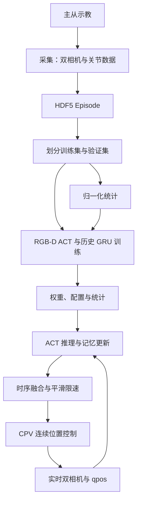

# PIPER_ACT 完整开发指南

> 适用项目：[liarzhip/PIPER_ACT](https://github.com/liarzhip/PIPER_ACT/tree/main)  
> 核对日期：2026-10-11  
> 核对提交：`38e243709516cdf5fb3851067b989db965e8f0e0`  
> 主线：Windows + PiPER-X + 腕部 Orbbec DaBai DC1 + 外部 RealSense + 双相机 RGB-D ACT + 全局 GRU 历史记忆 + CPV 执行。  
> 本文根据该提交的实际源码编写；命令、默认值与旧 README 冲突时，以本文注明的代码行为为准。官方链接属于上游文档，可能随版本更新。

## 目录

1. [项目定位与支持范围](#1-项目定位与支持范围)
2. [整体架构](#2-整体架构)
3. [目录与源码阅读顺序](#3-目录与源码阅读顺序)
4. [硬件准备](#4-硬件准备)
5. [软件环境安装](#5-软件环境安装)
6. [机械臂通信与相机验证](#6-机械臂通信与相机验证)
7. [示教与数据采集](#7-示教与数据采集)
8. [数据格式与质量检查](#8-数据格式与质量检查)
9. [统计文件与归一化](#9-统计文件与归一化)
10. [ACT 模型与历史记忆](#10-act-模型与历史记忆)
11. [训练流程](#11-训练流程)
12. [推理与实机部署](#12-推理与实机部署)
13. [网页上位机](#13-网页上位机)
14. [二次开发与双臂扩展](#14-二次开发与双臂扩展)
15. [测试与实验记录](#15-测试与实验记录)
16. [常见问题](#16-常见问题)
17. [官方文档导航](#17-官方文档导航)
18. [复现与交付清单](#18-复现与交付清单)

## 1. 项目定位与支持范围

### 1.1 项目做什么

PIPER_ACT 将 ACT 模仿学习适配到 PiPER-X：录制示教中的图像、关节反馈和目标动作，训练策略，再利用实时双相机画面和关节状态预测未来动作序列，通过 CPV 连续位置控制执行。

当前主线有以下特点：

- 两路视觉：`wrist` 为腕部 Orbbec，`external` 为外部 RealSense。
- 每路输入 RGB-D 四通道，而不是单纯 RGB。
- 当前机械臂状态与动作均为 7 维，通常表示 6 个关节和 1 个夹爪宽度。
- 允许 Episode 长度不同，动作块不足的部分用 padding 并在损失中屏蔽。
- 使用从 Episode 起点到当前时刻之前的 `qpos + action` 历史，由 GRU 编码。
- 执行中将 ACT 推理与 CPV 发送分开，配合时序融合、平滑、速度和加速度限制。
- 提供原生 JavaScript 前端与 Flask 后端，管理任务、采集、验证、训练和执行。

**文件名里的 `dual` 表示双相机，不表示当前已实现双从臂协作。** 训练入口明确拒绝 `state_dim != 7`。两台 PiPER-X 用于一主一从示教，也不等于策略同时控制两台执行臂。

### 1.2 当前仓库已包含完整核心文件

默认分支为 `main`。本指南核对的提交已包含数据采集、深度统计、验证、训练、执行与网页上位机的源码，不需要另行补充之前提到的本地采集文件。

| 文件 | 用途 |
| --- | --- |
| `数据采集/piper_act_recorder_windows_dual_rgbd_v7.py` | Windows 双相机 RGB-D 主从示教采集 |
| `数据采集/piper_act_recorder_Linux.py` | Linux 旧采集路径 |
| `数据采集/compute_depth_stats_dual.py` | 从训练集计算两路深度统计 |
| `数据采集/validate_act_episode.py` | Episode 结构、关节、采样频率、回放和曲线 |
| `数据采集/scripts/` | CAN、主从角色、机械臂与相机调试脚本 |
| `上位机/dual_validation.py` | V7 双相机深度结构、帧龄和同步差检查 |

Windows V7 采集模块将硬件 SDK 延迟到设备连接时导入。因此，具备 NumPy、OpenCV、h5py、Flask 等基础依赖的机器可以进行网页模拟、数据查看和验证；真实采集时再要求机械臂与相机 SDK。

“源码齐全”与“所有平台都具备相同功能”是不同结论。当前主线是 Windows V7 双相机；Linux 采集器仍属于旧路径，V7 执行器仍固定使用 Windows `agx_cando`。

### 1.3 旧说明与当前代码的差异

| 旧说明或易误解处 | 当前源码结论 |
| --- | --- |
| V4/V6 单相机命令 | 主线入口为 V7 双相机文件 |
| `conda_env.yaml` 的 `aloha` / Python 3.9 | 这是旧 ACT/仿真环境；网页说明要求 Python 3.10 或更新版本 |
| 启动端口有 5000、5088 两种 | `web_app.py` 默认 5000；启动器与 Vite 代理使用 5088 |
| 执行默认 `cpv_cv=0.30` | Python 执行入口默认 0.20；顶层示例显式传 0.30 |
| 执行默认无限时 | Python 执行入口默认 30 秒；显式 `--max_seconds 0` 才不限时 |
| 只携带权重与 `dataset_stats.pkl` | 应成套保留模型配置、统计与训练记录 |
| 不加 `--control` 就完全离线 | DRY-RUN 仍连接机械臂、读取反馈并打开相机 |

本指南主要给 Windows PowerShell 命令；反引号必须是每行最后一个字符。Bash 使用反斜杠续行，不能直接复制 PowerShell 续行符。

## 2. 整体架构



这里没有必须经过 YOLO 检测、点云配准或 MoveIt 规划的中间步骤。模型直接学习视觉和动作之间的关系。手眼标定不是当前 ACT 输入链的必需环节，但相机安装位置、视角和工作台布局必须与示教分布保持一致。

网页是管理界面；图像读取、HDF5 写入、训练和 CAN 通信都在 Python 进程中完成。

## 3. 目录与源码阅读顺序

### 3.1 当前文件职责

| 路径 | 职责 |
| --- | --- |
| `README.md` | 当前采集、训练和执行示例 |
| `数据采集/piper_act_recorder_windows_dual_rgbd_v7.py` | Windows 双相机采集、SI 单位转换、HDF5 写入 |
| `数据采集/compute_depth_stats_dual.py` | 每路有效深度统计、训练集划分与像素质量指标 |
| `数据采集/validate_act_episode.py` | 通用验证、单路回放、关节曲线 |
| `数据采集/scripts/piper_x_connect_test.py` | Windows pyAgxArm 只读关节反馈测试 |
| `act/train_piper_act_dual_rgbd_global_v7.py` | CUDA 训练入口，保存配置、统计、曲线与模型 |
| `act/utils_piper_dual_rgbd_global.py` | Episode 发现、结构检查、划分、归一化、RGB-D 加载、历史序列、collate |
| `act/policy_piper_dual_rgbd_global.py` | RGB-D 骨干适配、ACT 损失、GRU 记忆与优化器 |
| `act/detr/models/detr_vae.py` | ACT 的 CVAE、Transformer 和动作输出层 |
| `act/detr/models/backbone.py` | 视觉骨干和 FrozenBatchNorm |
| `act/run_piper_act_windows_smooth_cpv_v7_dual_rgbd_global.py` | 相机、机械臂连接、模型加载、时序融合、CPV 线程、退出处理 |
| `act/patch_act_model_for_piper.py` | 对旧模型的固定 14 维实现做适配；当前模型已使用可配置状态维度 |
| `上位机/web_app.py` | Flask 路由、设备采集管理、预览与验证 |
| `上位机/workflow.py` | 任务目录、参数转命令、训练与执行子进程 |
| `上位机/training_entry.py` | 自动准备训练集深度统计后调用 V7 |
| `上位机/dual_validation.py` | 双相机结构、帧龄与同步差检查 |
| `上位机/parameter_specs.json` | 网页可调整参数规范 |
| `上位机/frontend/` | HTML、CSS、JavaScript，Vite 开发与构建 |
| `上位机/tests/` | 上位机与参数集成测试 |
| `start_console.ps1` | Windows 后端健康检查、日志和浏览器启动 |
| `启动网页控制台.bat` | 双击启动入口 |

`act/` 中的仿真脚本与 ViperX XML 资产属于继承的 ACT 仿真路径，不能视为 PiPER-X 的真实动力学模型。

### 3.2 推荐阅读顺序

先看 `utils_piper_dual_rgbd_global.py` 理解数据，再看 `policy_piper_dual_rgbd_global.py` 和 `detr_vae.py` 理解网络，随后阅读训练入口、执行入口，最后看网页参数与进程管理。

源码跳转：[数据加载](https://github.com/liarzhip/PIPER_ACT/blob/main/act/utils_piper_dual_rgbd_global.py) · [策略网络](https://github.com/liarzhip/PIPER_ACT/blob/main/act/policy_piper_dual_rgbd_global.py) · [训练入口](https://github.com/liarzhip/PIPER_ACT/blob/main/act/train_piper_act_dual_rgbd_global_v7.py) · [执行入口](https://github.com/liarzhip/PIPER_ACT/blob/main/act/run_piper_act_windows_smooth_cpv_v7_dual_rgbd_global.py) · [网页后端](https://github.com/liarzhip/PIPER_ACT/blob/main/上位机/web_app.py)

## 4. 硬件准备

| 部件 | 当前用途 | 准备要点 |
| --- | --- | --- |
| PiPER-X 从臂 | 反馈与执行 | 固定底座、确认固件和夹爪型号 |
| 主臂或兼容示教设备 | 提供目标动作 | 与从臂关节顺序、零点、方向和夹爪定义一致 |
| USB-CAN | 上位机读取/控制 | Windows 执行路径使用 `agx_cando`，默认通道字符串 `0` |
| Orbbec DaBai DC1 | `wrist` RGB-D | 固定视角与走线，保证深度对齐彩色图 |
| RealSense | `external` RGB-D | 覆盖工作台与任务过程，必要时指定序列号 |
| NVIDIA GPU 电脑 | 训练与当前推理 | V7 训练代码直接调用 CUDA；4070 笔记本可从小批量起步，实际速度取决于显存和 Episode 长度 |
| USB 接口与线缆 | 两路相机供电/带宽 | 分开测试，再同时测试；避免相机与 CAN 在不稳定集线器上争用 |

两路相机的分辨率必须相同，例如均为 640×480。帧率可独立选择，但需要检查帧龄和采样时的同步差。

20 Hz 数据采样、30 FPS 相机、50 Hz CPV 是三个不同频率。主臂可能发送更高频率的 CAN 帧，并不意味着需要按同样频率写完整图像到 HDF5。

## 5. 软件环境安装

### 5.1 克隆项目与固定版本

以下示例将项目放在 `D:\piper_act`。该目录若已存在且有数据，不要覆盖；改用新的空目录。

```powershell
git clone --branch main https://github.com/liarzhip/PIPER_ACT.git D:\piper_act
Set-Location D:\piper_act
git rev-parse HEAD
```

需要复现本文对应版本时：

```powershell
git checkout 38e243709516cdf5fb3851067b989db965e8f0e0
```

这是固定提交查看状态；二次开发可再创建自己的分支。

### 5.2 建立 Conda 环境

对于新环境，先用 Python 3.10 作为兼容性起点。此选择是项目集成建议，不是所有 SDK 版本均已测试的保证。已有能稳定工作的 `piper_act` 环境应先导出依赖，不必重建。

```powershell
conda create -n piper_act python=3.10 -y
conda activate piper_act
python -m pip install --upgrade pip
python -c "import sys; print(sys.executable); print(sys.version)"
```

官方文档：[Conda 环境管理](https://docs.conda.io/projects/conda/en/stable/user-guide/tasks/manage-environments.html)。

### 5.3 安装 PyTorch

打开 [PyTorch 官方安装页面](https://pytorch.org/get-started/locally/)，选择 Windows、Pip、Python 与适合驱动的 CUDA 构建，执行页面生成的安装命令。不要仅根据本机 CUDA Toolkit 版本随意组合 `torch` 和 `torchvision`。

检查：

```powershell
nvidia-smi
python -c "import torch, torchvision; print('torch=', torch.__version__); print('torchvision=', torchvision.__version__); print('cuda=', torch.cuda.is_available()); print('gpu=', torch.cuda.get_device_name(0) if torch.cuda.is_available() else 'none')"
```

V7 训练入口要求 `torch.cuda.is_available()` 为真；当前策略初始化也直接使用 `.cuda()`，不能把 CPU 安装视为可直接替代。

### 5.4 安装训练与网页依赖

```powershell
Set-Location D:\piper_act
python -m pip install numpy h5py opencv-python matplotlib tqdm einops packaging ipython
python -m pip install -r .\上位机\requirements-web.txt
Set-Location .\act\detr
python -m pip install -e .
Set-Location D:\piper_act
python -m pip check
```

DETR 安装后，应在 `act` 目录能导入它内部的 `models` 和 `util`。不要安装一个同名但无关的 PyPI `detr` 包替代仓库目录。

旧的 `conda_env.yaml` 包含 MuJoCo、DM Control 和 ROS 相关工具；当前 PiPER V7 真实训练不要求安装整套 ROS 2。仿真开发再单独处理其依赖。

### 5.5 安装机械臂 SDK

采集接口依赖旧 `piper_sdk`；V7 执行程序依赖新 `pyAgxArm`。两者承担不同入口的职责。

```powershell
python -m pip install python-can "piper_sdk>=0.6.2"
python -m pip install "git+https://github.com/agilexrobotics/python-can-agx-cando.git"
python -m pip install "git+https://github.com/agilexrobotics/pyAgxArm.git"
```

安装后验证执行脚本需要的符号：

```powershell
python -c "from pyAgxArm import AgxArmFactory, ArmModel, PiperFW, create_agx_arm_config, resolve_firmware_profile; print('pyAgxArm imports OK')"
python -c "import piper_sdk, can; print('piper_sdk and python-can OK')"
```

官方跳转：[piper_sdk 中文说明](https://github.com/agilexrobotics/piper_sdk/blob/master/README%28ZH%29.MD) · [pyAgxArm](https://github.com/agilexrobotics/pyAgxArm) · [Windows CAN 插件](https://github.com/agilexrobotics/python-can-agx-cando) · [CAN 配置说明](https://github.com/agilexrobotics/pyAgxArm/blob/master/docs/can_user.md)。

采集器使用 `C_PiperInterface_V2.CreateCanBus()`，源码明确要求 `piper_sdk>=0.6.2`。使用前核对机械臂固件与 SDK API。导入成功不能证明 CPV、夹爪或固件配置已匹配；通过实机最小只读测试后再冻结 SDK 版本。

### 5.6 安装相机 SDK

**Orbbec：** 从 [pyorbbecsdk 官方仓库](https://github.com/orbbec/pyorbbecsdk) 或 [官方 Releases](https://github.com/orbbec/pyorbbecsdk/releases) 选择匹配 DaBai DC1、固件、Python 版本与 Windows 架构的包。官方仓库区分 SDK v1 与 v2 分支；不要假定所有 DaBai DC1 都应安装最新 v2 包。先用对应 SDK 的官方示例验证彩色流、深度流和 AlignFilter，再运行项目。

如使用官方提供的 wheel：

```powershell
python -m pip install "C:\下载目录\实际下载的pyorbbecsdk文件.whl"
python -c "from pyorbbecsdk import Pipeline, Config, OBSensorType, OBFormat; print('Orbbec imports OK')"
```

上面路径是占位示例，必须替换成真实文件。需要编译时，使用官方仓库中该分支的构建步骤，不要混用另一版本的 DLL 与 Python 扩展。

**RealSense：**

```powershell
python -m pip install pyrealsense2
python -c "import pyrealsense2 as rs; print([d.get_info(rs.camera_info.serial_number) for d in rs.context().query_devices()])"
```

官方跳转：[RealSense SDK](https://github.com/realsenseai/librealsense) · [Python wrapper](https://github.com/realsenseai/librealsense/tree/master/wrappers/python) · [SDK Releases](https://github.com/realsenseai/librealsense/releases)。

### 5.7 安装 Node.js 与构建前端

从 [Node.js 官方网站](https://nodejs.org/en/download) 安装适合本机的 LTS 版本，再执行：

```powershell
node --version
npm --version
Set-Location D:\piper_act\上位机\frontend
npm ci
npm run build
```

前端使用 Vite 6 系列，构建配置由当前 `package.json` 和 `package-lock.json` 决定。安装失败时核对 Node.js 引擎要求；不要直接删除 lockfile 来掩盖版本问题。

官方文档：[npm ci](https://docs.npmjs.com/cli/v11/commands/npm-ci) · [Vite](https://vite.dev/guide/)。

### 5.8 检查环境与入口

```powershell
Set-Location D:\piper_act
Test-Path .\数据采集\piper_act_recorder_windows_dual_rgbd_v7.py
Test-Path .\数据采集\compute_depth_stats_dual.py
Test-Path .\数据采集\validate_act_episode.py
python .\数据采集\piper_act_recorder_windows_dual_rgbd_v7.py --help
python .\数据采集\compute_depth_stats_dual.py --help
python .\数据采集\validate_act_episode.py --help
python .\act\train_piper_act_dual_rgbd_global_v7.py --help
```

`--help` 成功说明基础依赖和入口可导入；不会建立真实采集硬件连接，也不证明 CUDA 与控制模式正常。

## 6. 机械臂通信与相机验证

### 6.1 Windows 与 Linux 的差异

| 项目 | Windows 主线 | Linux 可用基础设施 |
| --- | --- | --- |
| CAN 后端 | `agx_cando` | 通常为 `socketcan` |
| 通道 | 字符串 `0` 等 | `can0` 等 |
| 项目 V7 执行脚本 | `_make_config()` 写死 `agx_cando` | 需要改通信配置，不能仅把通道改成 `can0` |
| 网页采集 | 使用 Windows V7 双相机模块 | 使用旧 Linux 模块，`RGBD_RECORDER=False` |

Linux 上配置 SocketCAN 的独立参考命令：

```bash
sudo apt install can-utils iproute2
sudo ip link set can0 down
sudo ip link set can0 up type can bitrate 1000000
ip -details link show can0
candump can0
```

这组命令只是官方 CAN 基础配置示例，不能使当前 Windows V7 执行器自动具备 Linux 支持。不要在 Windows PowerShell 执行它们。

### 6.2 主从示教

按照 [官方主从配置文档](https://github.com/agilexrobotics/piper_sdk/blob/master/asserts/double_piper.MD) 配置设备角色、接线与上电顺序。采集时需要区分：

- `qpos`：从臂实际反馈状态。
- `action`：主臂或示教接口给出的目标动作。

两者可因跟踪滞后而不同。当前采集器分别读取 `GetArmJointCtrl()/GetArmGripperCtrl()` 和 `GetArmJointMsgs()/GetArmGripperMsgs()`，不会用从臂反馈代替主臂目标。

主从角色、CAN ID、总线接线必须按现场硬件确认。采集器监听同一总线中的主臂控制帧与从臂反馈帧，不自动调用角色配置或控制使能。

仓库 `scripts/master.py` 和 `scripts/slave.py` 使用 Linux 的 `can0`，分别配置 `0xFA` 主臂、`0xFC` 从臂。它们会改变角色，不能直接照搬到 Windows，也不能当只读连接测试运行。

Windows 可先执行仓库的只读反馈测试：

```powershell
Set-Location D:\piper_act\数据采集\scripts
python .\piper_x_connect_test.py
```

该脚本使用 `PiperFW.DEFAULT` 与 `agx_cando` 通道 `0`；如果设备对应其他固件 profile，应先按官方文档修改配置。正常反馈后用 Ctrl+C 退出。

### 6.3 相机最小检查

1. 单独启动 Orbbec 官方示例，确认 RGB、深度与深度对齐。
2. 单独启动 RealSense Viewer，确认目标分辨率和深度流。
3. 关闭 Viewer 后同时打开两路相机，连续预览并移动机械臂。
4. 检查 wrist 线缆运动时是否掉帧，external 是否始终覆盖任务。
5. 确认深度输出单位为毫米，并检查深度缩放因子；不能把 SDK 原始整数直接当毫米。
6. 相机流稳定后再开始录制。

当前执行器的相机同步检查基于读取到的时间戳与帧龄；满足同步差阈值不等于已经建立硬件级同步。

## 7. 示教与数据采集

### 7.1 任务与 Episode

一个 Episode 应覆盖一次完整任务，例如“到达瓶子—抓取—移动—放置—结束”。先明确成功标准，保留成功、连贯、语义一致的示教。异常 Episode 单独归档。

不要求每段严格相同长度，但需要统一：相机位置、目标动作单位、夹爪编码、任务流程与合理的起始分布。手动回位可以使用；如果每段起点差异很大却没有相应示教覆盖，部署会进入训练分布之外。

建议先用少量完整示教验证工程链，再增加物体位置、朝向、照明与抓取姿态的变化。数据数量不作为成功率保证。

### 7.2 Windows 双相机采集命令

以下参数已与当前采集器 `parse_args()` 核对：

```powershell
conda activate piper_act
Set-Location D:\piper_act\数据采集
python .\piper_act_recorder_windows_dual_rgbd_v7.py `
  --dataset-dir "D:\piper_act\Dataset\stand_bottle_dual_rgbd" `
  --can-channel 0 `
  --can-backend agx_cando `
  --fps 20 `
  --wrist-width 640 `
  --wrist-height 480 `
  --wrist-fps 30 `
  --wrist-depth-min-mm 150 `
  --wrist-depth-max-mm 1500 `
  --external-width 640 `
  --external-height 480 `
  --external-fps 30 `
  --external-depth-min-mm 250 `
  --external-depth-max-mm 3000 `
  --max-image-age 0.10 `
  --max-camera-sync-delta 0.05
```

采集与深度统计参数主要采用连字符；训练和执行入口主要采用下划线。不要混用。

### 7.3 命令行按键与一次 Episode 的完整过程

1. 程序打开两路相机和 CAN，等待从臂反馈。
2. 主臂至少运动一次，让主臂目标初始化；未收到有效目标时不会开始正常采集。
3. 预览处于 READY，调整相机视角与起始姿态。
4. 让 OpenCV 预览窗口获得键盘焦点，按 `S` 开始录制。
5. 完成示教，按 `Q` 或 `ESC` 停止并保存，随后程序释放相机与 CAN 并退出。
6. 再运行同一命令录制下一段，文件编号自动递增。

| 选项 | 入口默认值 | 用法 |
| --- | --- | --- |
| `--preview` / `--no-preview` | 开启 | 无预览时按 Enter 开始，未设置时限时再按 Enter 停止 |
| `--duration` | 0 | 0 表示不自动按时长停止；正数在开始后达到时限结束 |
| `--episode-index` | 自动 | 显式指定编号；已有目标文件会报错，不会覆盖 |
| `--startup-timeout` | 10 秒 | 相机和机械臂初始化等待 |
| `--external-serial` | 空 | 多个 RealSense 时指定目标设备 |
| `--wrist-depth-align` | 开启 | 保持深度与彩色图一致 |
| `--judge-flag` | False | Windows CAN 不按 Linux SocketCAN 接口检测 |

默认图形模式的 `Q/ESC` 是结束当前进程；要在同一次连接中连续录多段，可使用网页工作台。

### 7.4 HOLD、采样与保存

主臂静止时，采集器保留最后一个有效主臂 action；没有初始化时不把缺失目标当成零关节角。`action_updated` 和 action 帧龄作为诊断数据保存。

采集器跳过相机尚未就绪、图像超过帧龄、两路主机时间戳差超过阈值、从臂反馈不可用或主臂尚未初始化的 tick。20 Hz 是期望采样率；跳过 tick 会导致有效采样间隔变长，必须检查实际时间戳。

命令行采集器直接创建 `.hdf5`，采用缓存批量写入，在 `finally` 中尝试 flush 和 close；Ctrl+C 时也尝试保存。零样本文件会给出警告，应检查或移出训练目录。强制终止或断电不能保证文件完整。

网页采集另加 `.hdf5.partial` 临时文件，正常保存后再重命名为 `.hdf5`，并可标记录制异常。两种保存流程不要混为一谈。

### 7.5 网页连续采集

在任务中心选择任务，连接并预览；移动主臂初始化；调整起点后开始录制，完成任务后停止并保存，再录下一段。停止录制不释放设备，“断开”才结束采集连接；停止录制也不等于停止机械臂运动。

关闭网页不等于结束后端；需要重新打开页面查看状态。正常保存的 Episode 与模拟演示数据位于不同目录，模拟数据不计入正式训练。

## 8. 数据格式与质量检查

### 8.1 V7 最小数据结构

| HDF5 路径 | 形状 | 含义 |
| --- | --- | --- |
| `/observations/qpos` | `[T,7]` | 从臂反馈 |
| `/action` | `[T,7]` | 示教目标 |
| `/observations/images/wrist` | `[T,H,W,3]` | 腕部 RGB |
| `/observations/depth/wrist` | `[T,H,W]` | 腕部对齐深度，毫米 |
| `/observations/images/external` | `[T,H,W,3]` | 外部 RGB |
| `/observations/depth/external` | `[T,H,W]` | 外部对齐深度，毫米 |

网页双相机检查期望 RGB 为 `uint8`、深度为 `uint16`。各流长度一致、两路相机 H×W 相同、每路 RGB 与深度尺寸一致。

采集器已执行 SI 单位转换：前六维原始值乘 `1e-3 × π / 180` 转为弧度，夹爪原始值乘 `1e-6` 转为米。模型与执行器使用前六维弧度、最后一维米。RGB 存为 RGB 顺序，深度存为毫米 `uint16`，零为无效值。原始协议值另存 `/raw/qpos` 与 `/raw/action`。

HDF5 属性记录 `joint_unit=rad`、`gripper_unit=m`、`image_encoding=rgb8`、`depth_encoding=uint16_mm`、采样频率、CAN 后端和每路相机范围。自定义采集器也必须遵守这些定义。模型不会自行发现单位错误。

### 8.2 时间质量字段

网页 `dual_validation.py` 还检查：

| 路径 | 意义 |
| --- | --- |
| `/timestamps/wrist_image_age_s` | 腕部图像帧龄，秒 |
| `/timestamps/external_image_age_s` | 外部图像帧龄，秒 |
| `/timestamps/camera_sync_delta_s` | 两路采样时间差，秒 |

这些字段应有 T 个有限、非负值。默认帧龄阈值 0.10 秒、同步差阈值 0.05 秒。训练 loader 只检查基础结构，不等于会自动剔除所有同步差大、非有限关节或录制中断的数据。

### 8.3 原验证器、回放与曲线

```powershell
Set-Location D:\piper_act\数据采集
python .\validate_act_episode.py `
  "D:\piper_act\Dataset\stand_bottle_dual_rgbd\episode_000000.hdf5" `
  --plots
```

生成 `episode_000000_validation/` 目录，包含 J1～J6 与夹爪的 qpos/action 对比曲线。关节显示角度，夹爪显示毫米，不改变原数据单位。

```powershell
python .\validate_act_episode.py `
  "D:\piper_act\Dataset\stand_bottle_dual_rgbd\episode_000000.hdf5" `
  --play
```

回放按键：空格暂停/继续；暂停时 A 上一帧、D 下一帧；Q/ESC 退出。

当前通用验证器仍保留旧单相机逻辑：没有 `camera_name` 属性时选择图像组中的第一路，并查找旧 `timestamps/image_age_s`。V7 保存的是分别带相机名的帧龄字段，因此可能看到 `No /timestamps/image_age_s` 警告；不能把这条警告直接解释为 V7 文件缺少所有帧龄。

单独运行 `--play` 不保证显示两路相机，也不完整检查两路深度。网页回放会拼接双相机，网页验证在通用验证后调用 `dual_validation.py`。

### 8.4 双相机与时间质量检查

在项目根目录保存并运行下面的只读示例，调用现有双相机验证函数：

```python
from pathlib import Path
import sys

root = Path(r"D:\piper_act")
sys.path.insert(0, str(root / "上位机"))
from dual_validation import validate_dual

folder = root / "Dataset" / "stand_bottle_dual_rgbd"
for path in sorted(folder.glob("episode_*.hdf5")):
    status, report = validate_dual(path, max_age=0.10, max_sync=0.05)
    print(path.name, status)
    print(report)
```

基础 loader 的结构检查可在 `act` 目录运行：

```python
from pathlib import Path
from utils_piper_dual_rgbd_global import discover_episode_files, validate_episode_file

folder = Path(r"D:\piper_act\Dataset\stand_bottle_dual_rgbd")
for path in discover_episode_files(folder):
    n = validate_episode_file(path, ["wrist", "external"], 7)
    print(path.name, "frames=", n)
```

至少需要两个有效 Episode。文件名需为 `episode_数字.hdf5`，loader 不递归搜索子目录。

抽查抓取前、夹爪闭合、抬升与放置帧；检查 NaN/Inf、动作跳变、HOLD 比例、跟踪误差、深度有效率、RGB 颜色与实际采样间隔。结构合格只是进入训练的必要条件。

## 9. 统计文件与归一化

### 9.1 统计只从训练集计算

当前 loader 按 Episode 打乱并划分，而不是将同一 Episode 的相邻帧分到两侧。`seed`、`train_ratio`、`max_episodes` 决定样本划分，应与深度统计使用相同配置。

qpos/action 的均值和标准差由训练集真实帧计算；padding 不参与统计。每个维度的标准差至少为 `1e-2`。

深度处理分两步：先按每路相机的毫米范围裁剪，映射到 `[0,1]`；再用该路训练集的 `depth_mean`、`depth_std` 标准化。无效深度填充该路均值，标准化后为零。RGB 使用其对应的归一化流程。

**深度均值和标准差必须是裁剪映射后的无量纲统计值，不能直接填写毫米均值。**

### 9.2 统计文件结构

默认查找数据目录中的 `depth_stats_dual.json`。它至少包含：

```text
cameras
  wrist
    depth_mean
    depth_std
    depth_min_mm
    depth_max_mm
  external
    depth_mean
    depth_std
    depth_min_mm
    depth_max_mm
```

若文件记录了 `train_ratio` 或 `seed`，loader 会校验是否与训练参数相同。更完整的记录应保留训练文件清单、验证文件清单、相机顺序与范围。

### 9.3 使用仓库统计器

```powershell
Set-Location D:\piper_act\数据采集
python .\compute_depth_stats_dual.py `
  --dataset-dir "D:\piper_act\Dataset\stand_bottle_dual_rgbd" `
  --camera-names wrist external `
  --wrist-depth-min-mm 150 `
  --wrist-depth-max-mm 1500 `
  --external-depth-min-mm 250 `
  --external-depth-max-mm 3000 `
  --train-ratio 0.8 `
  --seed 0 `
  --frame-chunk 8
```

默认输出 `depth_stats_dual.json` 到数据集目录。脚本分块读取有效深度，裁剪并映射到 `[0,1]`，按像素累计均值和总体标准差；不会将零深度计为有效样本。

同时输出每路有效/无效像素比例、低端/高端裁剪比例、文件数与帧数。若有效率太低或大量深度被裁剪到边界，先调整实际拍摄距离、对齐与统计范围。标准差为零时，训练 loader 会拒绝统计文件，应检查数据而不是填写任意值。

| 参数 | 作用 |
| --- | --- |
| `--frame-chunk` | 每次读取帧数，必须取正整数；默认 8 |
| `--output-json` | 显式指定输出文件，父目录应已存在 |
| `--use-all` | 使用全部 Episode 统计；正式训练/验证流程不要使用，以免验证集泄漏 |

直接统计器会写入/覆盖目标 JSON。已有实验应先保存原统计，修改范围或划分后用新模型目录；不要给旧权重配一份新统计。

### 9.4 网页自动统计与直接训练的区别

网页通过 `上位机/training_entry.py` 启动训练。没有显式统计路径时，它优先采用数据目录现有 `depth_stats_dual.json`；否则根据当前 seed、train_ratio、max_episodes 与每路相机属性范围，只从训练集计算统计，并保存在 `.depth_stats-cache/`。

缓存签名包含文件路径、大小、修改时间、划分与范围，方便同配置复用。不同训练 Episode 的同路深度范围不一致时，自动预处理会报错。

`act/train_piper_act_dual_rgbd_global_v7.py` 直接入口不会自动计算统计；运行前执行第 9.3 节，或显式传统计路径。

若训练使用 `--max_episodes`，独立统计器没有对应截断参数。此时建议使用网页/包装入口自动计算，并不要复用基于完整数据集生成的旧统计：

```powershell
Set-Location D:\piper_act\上位机
python .\training_entry.py `
  --dataset_dir "D:\piper_act\Dataset\stand_bottle_dual_rgbd" `
  --ckpt_dir "D:\piper_act\checkpoints\stand_bottle_v7_subset" `
  --camera_names wrist external `
  --max_episodes 20 `
  --num_epochs 5 `
  --batch_size 2 `
  --train_ratio 0.8 `
  --seed 0
```

上述包装入口在未指定统计路径时仍优先使用现有统计 JSON；要重新自动生成，应使用未带旧统计文件的数据集或先将旧文件备份移出默认位置。

## 10. ACT 模型与历史记忆

### 10.1 输入输出

| 张量 | 形状 | 含义 |
| --- | --- | --- |
| `image` | `[B,2,4,H,W]` | 两路 RGB-D，固定相机顺序 |
| `qpos` | `[B,7]` | 当前归一化机械臂状态 |
| `global_history` | `[B,L,14]` | 严格过去的 qpos 与 action 拼接 |
| `global_history_lengths` | `[B]` | 变长历史的真实长度 |
| 目标动作 | `[B,K,7]` | 从 t 开始的未来 K 步动作 |
| `is_pad` | `[B,K]` | 动作块 padding 标记 |
| 输出动作 | `[B,K,7]` | 归一化目标动作序列 |

`K=chunk_size`。20 Hz 下 K=20 对应约 1 秒动作预测范围。

### 10.2 网络计算

RGB-D 视觉骨干将原 RGB 输入卷积改为 4 通道；Transformer 融合视觉、关节状态和潜变量，动作头输出一组未来关节/夹爪目标。DETR 结构在这里用于动作序列预测，不是在进行物体检测。

全局历史 GRU 输入每步 14 维的归一化 `qpos + action`，输出隐状态，经 LayerNorm、线性层和 tanh 得到 7 维残差，加入当前归一化 qpos 后作为 ACT 条件。

历史只包含 `0 ... t-1`，避免把当前或未来目标泄漏给条件编码。Episode 起点无历史时使用零记忆；部署每次新任务也需重置记忆。`global_history_stride` 调整历史取样密度，不改变未来动作块中相邻目标的原始时间间隔。

### 10.3 训练与推理的差别

训练时 CVAE 编码当前状态和示教动作，得到潜变量分布；推理时没有未来示教动作，源码使用零潜变量。GRU 部署阶段递推更新；历史中的 action 也不再是教师示教，而来自实际执行链选择的动作，因此需要检查训练与部署历史定义是否一致。

损失为：

```text
loss = valid_action_L1 + kl_weight × KL
```

其中动作 L1 仅对非 padding 元素求平均。这个目标不直接度量碰撞、抓取成功或物体最终位置。

### 10.4 哪些参数得到训练

当前优化器覆盖 ACT 中 `requires_grad=True` 的参数，并为 backbone 设置 `lr_backbone`，再追加全局 GRU 编码器参数。包含视觉卷积、Transformer、动作投影/CVAE 相关层以及 GRU、LayerNorm、历史残差输出层。FrozenBatchNorm 中的统计与仿射值为 buffer，不属于正常训练参数。

当前代码没有视觉网络与动作网络的梯度分离。若加入知识绝缘、冻结骨干或额外损失，必须单独实现并进行对照实验。

官方算法资料：[ACT 代码](https://github.com/tonyzhaozh/act) · [ALOHA 项目页面](https://tonyzhaozh.github.io/aloha/) · [原论文](https://arxiv.org/abs/2304.13705)。

## 11. 训练流程

### 11.1 开始前检查

确认至少两个完整双相机 Episode；相机顺序为 `wrist external`；深度统计已生成；CUDA 可用；`act/detr` 已安装；输出使用新的 checkpoint 目录。

### 11.2 先运行短训练

直接使用仓库已有 V7 入口，显式传统计文件：

```powershell
conda activate piper_act
Set-Location D:\piper_act\act
python .\train_piper_act_dual_rgbd_global_v7.py `
  --dataset_dir "D:\piper_act\Dataset\stand_bottle_dual_rgbd" `
  --ckpt_dir "D:\piper_act\checkpoints\stand_bottle_v7_smoke" `
  --depth_stats_json "D:\piper_act\Dataset\stand_bottle_dual_rgbd\depth_stats_dual.json" `
  --camera_names wrist external `
  --num_epochs 5 `
  --batch_size 2 `
  --chunk_size 20 `
  --sample_stride 2 `
  --train_ratio 0.8 `
  --seed 0 `
  --num_workers 0
```

这验证加载、前向、反向、保存与日志，不代表模型已具备完成任务的能力。

### 11.3 正式训练参考命令

```powershell
python .\train_piper_act_dual_rgbd_global_v7.py `
  --dataset_dir "D:\piper_act\Dataset\stand_bottle_dual_rgbd" `
  --ckpt_dir "D:\piper_act\checkpoints\stand_bottle_v7_run01" `
  --depth_stats_json "D:\piper_act\Dataset\stand_bottle_dual_rgbd\depth_stats_dual.json" `
  --camera_names wrist external `
  --num_epochs 50 `
  --batch_size 8 `
  --chunk_size 20 `
  --sample_stride 2 `
  --global_history_stride 1 `
  --global_hidden_dim 128 `
  --global_residual_scale 1.0 `
  --kl_weight 10 `
  --hidden_dim 512 `
  --dim_feedforward 3200 `
  --lr 1e-5 `
  --lr_backbone 1e-5 `
  --train_ratio 0.8 `
  --seed 0 `
  --num_workers 0
```

50 轮是仓库默认和初始参考，不是训练充分的结论。根据独立验证与实际任务表现调整训练时长。原 ACT 官方也提示损失趋稳后，行为表现仍可能变化；不同项目的每轮样本数不同，不能只比较 epoch 数。

### 11.4 关键参数

| 参数 | 入口默认值 | 作用与调整方向 |
| --- | --- | --- |
| `batch_size` | 8 | 显存不足先降至 4、2 或 1 |
| `chunk_size` | 20 | 预测动作长度；改变后使用新模型目录 |
| `sample_stride` | 2 | 只选每隔 N 帧的训练起点；目标动作仍连续 |
| `global_history_stride` | 1 | 历史取样间隔，增加可降低长历史开销 |
| `global_hidden_dim` | 128 | 历史 GRU 隐状态维度 |
| `global_residual_scale` | 1.0 | qpos 条件历史残差幅度 |
| `hidden_dim` | 512 | Transformer 特征维度，需匹配注意力头数 |
| `dim_feedforward` | 3200 | Transformer 前馈层维度 |
| `enc_layers` / `dec_layers` | 4 / 7 | 编码器与解码器深度 |
| `nheads` | 8 | 注意力头数 |
| `kl_weight` | 10 | CVAE KL 权重 |
| `lr` / `lr_backbone` | 1e-5 / 1e-5 | 主网络与视觉骨干学习率 |
| `train_ratio` / `seed` | 0.8 / 0 | Episode 划分，必须与统计匹配 |
| `num_workers` | 0 | Windows 首次调试建议保持 0 |
| `save_every` / `plot_every` | 10 / 10 | 周期保存与绘图间隔 |

改变 sample_stride 会改变每轮样本数；它不会把 20 Hz 的未来动作目标自动变成 10 Hz。

### 11.5 输出与恢复限制

| 文件 | 用途 |
| --- | --- |
| `policy_best.ckpt` | 验证损失最佳的策略权重 |
| `policy_last.ckpt` | 最后一轮策略权重 |
| `model_config.json` | 相机顺序与网络结构 |
| `dataset_stats.pkl` | qpos/action 与每路深度统计 |
| `dataset_split.json` | Episode 划分 |
| `training_history.json` | 训练、验证指标与参数 |
| `train_val_loss.png`、`train_val_l1.png`、`train_val_kl.png` | 曲线 |

部署复制整个模型目录最稳妥。不得混用不同实验的权重、统计和模型配置。

当前训练器没有提供标准的断点续训参数；保存 `policy_last.ckpt` 不意味着包含优化器状态、随机状态和学习率调度恢复能力。同配置目录可通过兼容检查，也不等于自动从旧权重继续训练。要实现恢复训练，应增加明确的加载和完整训练状态保存逻辑。

## 12. 推理与实机部署

### 12.1 先仅推理

采集结束后释放相机。DRY-RUN 仍需要真实机械臂反馈和两路相机；它不发送正常策略运动指令，也不是离线视频评测工具。

```powershell
conda activate piper_act
Set-Location D:\piper_act\act
python .\run_piper_act_windows_smooth_cpv_v7_dual_rgbd_global.py `
  --ckpt_dir "D:\piper_act\checkpoints\stand_bottle_v7_run01" `
  --can_channel 0 `
  --control_hz 20 `
  --cpv_hz 50 `
  --wrist_width 640 `
  --wrist_height 480 `
  --wrist_fps 30 `
  --external_width 640 `
  --external_height 480 `
  --external_fps 30 `
  --max_image_age 0.10 `
  --max_camera_sync_delta 0.05 `
  --max_seconds 30
```

窗口提示后按 `S` 开始策略与伺服循环；按 `Q` 或 `ESC` 退出。需要检查两路画面、单位、输出趋势、帧龄、同步差、推理耗时和状态分布。不可仅凭“程序不报错”进入控制。

### 12.2 实机控制命令

下面命令必须在确认示教主臂不再向该从臂发送控制、工作区条件满足并已验证 DRY-RUN 后执行。参数沿用仓库示例，但首次只运行有限时间；它们不是针对所有负载与固件的安全认证值。

```powershell
python .\run_piper_act_windows_smooth_cpv_v7_dual_rgbd_global.py `
  --ckpt_dir "D:\piper_act\checkpoints\stand_bottle_v7_run01" `
  --control `
  --can_channel 0 `
  --cpv_cv 0.30 `
  --speed_percent 15 `
  --control_hz 20 `
  --cpv_hz 50 `
  --wrist_width 640 `
  --wrist_height 480 `
  --wrist_fps 30 `
  --external_width 640 `
  --external_height 480 `
  --external_fps 30 `
  --joint_alpha 0.20 `
  --gripper_alpha 0.15 `
  --max_joint_vel_deg_s 15 `
  --max_joint_acc_deg_s2 60 `
  --max_tracking_error_deg 5 `
  --max_joint_step_deg 1.0 `
  --target_timeout 0.30 `
  --max_camera_sync_delta 0.05 `
  --max_seconds 30
```

命令行会要求输入 `CONTROL`，图形窗口再按 `S` 启动循环。`--control` 路径会使能机械臂并配置控制模式，不应理解为所有硬件配置都等到按 S 才发生。

`--max_seconds 0` 表示取消程序的运行时限，不代表自动识别任务结束。当前执行没有基于任务成功的通用自动终止器。

### 12.3 CPV 流程与频率

ACT 每次预测 K 步动作；启用 temporal aggregation 时融合多个历史预测中对应同一当前时刻的目标。随后平滑器处理目标，CPV 线程按独立频率发送连续位置。

| 参数 | 作用 |
| --- | --- |
| `control_hz` | ACT 推理/目标更新期望频率 |
| `cpv_hz` | CPV 位置发送期望频率 |
| `joint_alpha`、`gripper_alpha` | EMA 平滑系数；减小通常更平缓但增加滞后 |
| `max_joint_vel_deg_s` | 关节速度限制 |
| `max_joint_acc_deg_s2` | 关节加速度限制 |
| `max_joint_step_deg` | 目标步进相关约束 |
| `max_tracking_error_deg` | 指令与实测关节的跟踪误差约束 |
| `target_timeout` | 目标过期处理阈值 |
| `cpv_cv` | 控制器各轴 CPV 的 CV 参数，含义以固件/API 为准 |
| `max_qpos_z` | 归一化状态偏离训练分布的阈值 |
| `temporal_k` | 时序融合权重衰减参数 |

`cpv_cv=0.30` 不能直接解释为末端速度 0.30 m/s，也不等于 `speed_percent=30`。推理耗时超过 50 ms 时，20 Hz 是目标频率而非保证。

### 12.4 停止与故障

源码正常退出和 KeyboardInterrupt 路径尝试 `hold_current()`；异常路径尝试 `emergency_stop()`。网页通过停止文件通知执行程序进入退出流程。软件保持、通信中断与物理急停的效果不同，不能把它们等同。

当前主线没有通用碰撞检测、工作空间避障或接触力闭环；限速与跟踪误差约束不能替代这些能力。

官方跳转：[PiPER API](https://github.com/agilexrobotics/pyAgxArm/blob/master/docs/piper/piper_api.md) · [驱动示例](https://github.com/agilexrobotics/pyAgxArm/tree/master/pyAgxArm/demos)。

## 13. 网页上位机

### 13.1 生产式本地启动

完成基础 Python 环境与前端安装后：

```powershell
conda activate piper_act
Set-Location D:\piper_act\上位机\frontend
npm ci
npm run build
Set-Location ..
python .\web_app.py --host 127.0.0.1 --port 5088
```

访问 [本地工作台](http://127.0.0.1:5088)。不传端口时，Python 后端默认 5000；这里显式指定 5088，与 Vite 和双击启动器保持一致。

### 13.2 双击启动器

根目录批处理调用 `start_console.ps1`。默认寻找用户目录中的 `anaconda3\envs\piper_act\python.exe`；不同安装位置可在 PowerShell 显式指定：

```powershell
conda activate piper_act
Set-Location D:\piper_act
$env:PIPER_PYTHON = (Get-Command python).Source
.\start_console.ps1 -Port 5088
```

只启动后端可加 `-NoBrowser`。启动器不会自动安装 Node.js 或 `node_modules`；首次必须运行 `npm ci`。前端已修改时，它会尝试重新构建，后端健康检查成功后再打开浏览器。

日志位于 `上位机/Log/console-*.out.log` 与 `console-*.err.log`。端口被无关进程占用时会报错，不应直接结束未知进程。

### 13.3 开发模式

终端一：

```powershell
conda activate piper_act
Set-Location D:\piper_act\上位机
python .\web_app.py --port 5088
```

终端二：

```powershell
Set-Location D:\piper_act\上位机\frontend
npm run dev
```

访问 [Vite 开发页面](http://127.0.0.1:5173)。`/api` 代理到 5088。修改后端端口时，还要修改 `vite.config.js` 的代理目标。`npm run preview` 使用 4173，也需要后端。

### 13.4 页面功能

| 功能 | 主要行为 |
| --- | --- |
| 任务中心 | Dataset/checkpoints 目录与任务注册表关联；运行中不允许切换 |
| 采集 | 连接、预览、开始、停止保存、断开 |
| 回放 | HDF5 图像与关节数据；双相机视图 |
| 验证 | 调用原验证器，再加入双相机检查 |
| 训练 | 通过选择的 Python 环境启动 training_entry |
| 执行 | 默认仅推理；真实控制需确认，启动 V7 子进程 |
| 环境检测 | 检查模块是否存在，不证明 DLL 或设备可正常运行 |

真实采集由后端本身运行的环境负责；在网页选择其他环境主要影响训练与执行子进程，不会重新启动当前后端。

新任务目录通常包含唯一后缀；任务删除会涉及数据和模型目录，不是只删除界面条目。任务注册表可能带有开发机路径，迁移后必须核对实际目录。

### 13.5 API 二次开发入口

| API | 用途 |
| --- | --- |
| `GET /api/health` | 健康检查 |
| `GET /api/status` | 采集状态 |
| `GET /api/tasks` | 任务列表 |
| `POST /api/tasks` | 创建任务 |
| `POST /api/tasks/<task_id>/select` | 切换任务 |
| `GET /api/environments` | Python 环境 |
| `POST /api/connect` | 连接预览 |
| `POST /api/start`、`POST /api/stop` | 开始、保存采集 |
| `POST /api/disconnect` | 释放采集设备 |
| `GET /api/episodes` | Episode 列表 |
| `POST /api/episodes/<name>/validate` | 数据验证 |
| `POST /api/training/start`、`POST /api/training/stop` | 训练管理 |
| `POST /api/execution/start`、`POST /api/execution/stop` | 执行管理 |
| `GET /api/execution/preview.jpg` | 执行图像预览 |

请求字段应以源码与 `parameter_specs.json` 为准；真实控制接口检查 `control` 与 `motion_confirmed`。不要把内部 `--web_authorized` 当成普通命令行跳过确认的推荐用法。

默认仅本机访问。局域网需求需另外配置绑定、网络访问和服务保护；当前 Flask 工作台没有账户认证体系，不应直接用于公网机器人控制。

官方文档：[Flask](https://flask.palletsprojects.com/en/stable/) · [MDN JavaScript](https://developer.mozilla.org/zh-CN/docs/Web/JavaScript) · [Vite 配置](https://vite.dev/config/)。

## 14. 二次开发与双臂扩展

### 14.1 扩展采集与相机模块

Windows 后端使用已有 `HDF5EpisodeWriter`、`OrbbecCamera`、`RealSenseCamera`、`PiperReader`、`next_episode_path`。改相机型号或增加一路时，应同步调整构造参数、取帧返回值、时间戳、HDF5 路径、预览、统计与训练配置。

建议维持 `get_latest()` 的 RGB、深度毫米图、主机单调时间戳契约，连接成功后才使用真实 SDK。写入模块需统一保存 SI 单位、原始值和时间质量字段。

当前时间戳反映主机收帧链的时刻，不是已经校准过的跨设备曝光时间。需要高精度同步时，应增加设备时间映射或硬件同步，并评估图像与关节采样的实际延迟。

采样器丢弃 tick 后，loader 仍按帧索引取连续未来动作。若实际间隔波动明显，先改善采集链，再考虑按统一时间网格重采样或向模型加入时间间隔特征。

### 14.2 支持 Linux

需要改执行器 CAN 工厂配置，提供 SocketCAN 通道选项；统一 Linux 双相机采集模块与 Windows HDF5 schema；检查 USB 权限、SDK 库、界面与退出行为；最后做 Windows 训练到 Linux 部署的一致性测试。

训练本身主要依赖 CUDA/PyTorch 和 HDF5，与 ROS 2 无强制耦合。接入 ROS 2 可将机械臂状态、相机或任务接口封装成节点，但应先决定谁唯一拥有运动控制权。

### 14.3 扩展到两个执行臂

两臂各 6 关节与 1 夹爪时，一种布局为 `[left_7D, right_7D]`，共 14 维。当前代码虽然 DETR 层可配置维度，V7 训练入口和执行器仍含单臂假设，不能只改 `--state_dim 14`。

必须同步修改：

1. 采集器：两臂反馈、两臂目标、时间戳和角色配置。
2. 数据格式与单位：明确左右顺序，所有 Episode 统一。
3. loader 与训练入口：移除 7 维限制，使用 14 维统计与目标。
4. GRU：输入变为 28 维，输出条件残差为 14 维。
5. 执行器：两个独立通信实例和夹爪、动作拆分、协调开始与停止。
6. 安全约束：两臂互碰、共享工作区、通信异常时的协调处理。
7. 相机：可继续两路或扩展为左右腕部与外部全景，修改相机数限制与配置。

叠衣服需要覆盖布料变形、遮挡、两臂交接、起始布料状态变化。固定小范围任务先验证同步和基本行为，再扩大泛化。当前瓶类示教任务的模型不能直接迁移为双臂叠衣策略。

### 14.4 视觉冻结或梯度隔离

冻结骨干可设置对应参数 `requires_grad_(False)` 并调整优化器。仅把 `lr_backbone` 设为零不等价于完整冻结或梯度绝缘。

视觉特征后 `detach()` 会阻止动作损失更新视觉骨干。如果没有视觉辅助目标或足够合适的预训练特征，新增深度通道也可能失去有效训练。对照实验应保持数据划分、单位、种子和评测过程一致，报告成功率、动作平滑度、恢复行为与推理耗时。

### 14.5 新增参数的正确路径

新增一个网页控制参数时，同时更新 `parameter_specs.json`、前端表单、`workflow.py` 的转换与约束、目标脚本解析器，并检查现有参数集成测试。不能只在网页上增加输入框就认定参数已生效。

## 15. 测试与实验记录

### 15.1 软件测试

```powershell
conda activate piper_act
Set-Location D:\piper_act\上位机
python -m unittest discover -s tests -v
Set-Location .\frontend
npm run build
```

仓库测试主要使用模拟或桩对象；通过它们不证明真实相机、固件和 CAN 已通过验证。无硬件网页演示用于软件链验证，不能替代主从反馈与真实 RGB-D 采集。

### 15.2 分阶段验收

| 阶段 | 通过条件 |
| --- | --- |
| 环境 | 目标解释器、CUDA、SDK 与 DLL 加载正确 |
| 只读硬件 | 关节/夹爪反馈、固件读取、两路相机稳定 |
| 采集 | 完整 Episode、单位一致、时序合格、异常保存可追踪 |
| 训练 | 有限 loss、真实划分、统计与模型成套保存 |
| DRY-RUN | 画面顺序、预测趋势、状态范围与推理频率合理 |
| 有限实机试验 | 无竞争控制、动作方向正确、停止流程可靠 |
| 任务评估 | 独立起始条件下统计成功率、失败类型和运行时间 |

成功率定义为成功次数除以总试验次数。应另外记录抓取失败、视觉失效、抖动、超时、目标漂移与人为终止，避免只报告成功片段。

### 15.3 保存实验环境

```powershell
Set-Location D:\piper_act
New-Item -ItemType Directory -Force .\experiment_records
python -m pip freeze | Out-File -Encoding utf8 .\experiment_records\requirements-lock.txt
conda env export --no-builds | Out-File -Encoding utf8 .\experiment_records\environment.yml
git rev-parse HEAD | Out-File -Encoding utf8 .\experiment_records\commit.txt
nvidia-smi | Out-File -Encoding utf8 .\experiment_records\gpu.txt
```

另外记录机械臂固件、相机固件、相机安装照片、图像设置、CAN 设备、数据采样率、训练命令和执行参数。大数据集、checkpoint、Conda 环境和 SDK 二进制不宜直接提交为普通 Git 文件，按项目数据管理方案保存。

## 16. 常见问题

| 现象 | 排查与处理 |
| --- | --- |
| 后端提示找不到 `piper_act_recorder_windows_dual_rgbd_v7` | 核对是否克隆当前 main、是否保留完整目录结构，避免只复制上位机目录 |
| 模拟模式启动失败 | 核对 NumPy、h5py、OpenCV、Flask 与平台采集器的基础导入；Windows 的硬件 SDK 在连接时才加载 |
| `compute_depth_stats_dual` 导入失败 | 核对 main 分支与 `数据采集/` 相对路径；使用项目根目录完整结构 |
| `Depth statistics not found` | 准备双相机统计，确认 `--depth_stats_json` 指向正确文件 |
| CUDA 不可用 | 核对当前环境、驱动和 PyTorch 构建；训练入口无 CPU 路径 |
| 找不到 `models` / `util` | 在当前环境对 `act/detr` 执行 editable install，并从 `act` 工作目录运行 |
| pyAgxArm 缺少符号 | SDK 与脚本不兼容，按项目实际 API 选择版本；不要随意替换类名 |
| Orbbec 无设备 | 先确认厂商工具可见，核对 SDK 分支、固件、USB 和驱动 |
| AlignFilter 或 profile 不支持 | 检查设备支持的实际分辨率与对齐方式，不能仅靠关闭对齐维持 RGB-D 语义 |
| RealSense 设备占用 | 关闭 Viewer、采集器或其他持有 pipeline 的进程 |
| 两路相机尺寸不同 | 采集时统一 H×W；现有数据如重采样，RGB/深度都须对齐处理 |
| V7 出现 `No /timestamps/image_age_s` 警告 | 通用验证器在查旧字段，使用双相机验证函数检查 wrist/external 的独立帧龄 |
| 旧单相机数据训练报错 | V7 需要两路图像和深度，不能把旧文件改名就满足要求 |
| wrist/external 混淆 | 检查 HDF5 名称、训练相机顺序和部署配置 |
| seed/train_ratio 不匹配 | 用同一 Episode 划分重算统计；不要删除校验字段掩盖问题 |
| checkpoint 目录配置冲突 | 建新实验目录，保留旧权重、统计和配置 |
| 显存不足 | 先降 batch，再评估历史长度或模型规模；修改结构需重新训练 |
| OpenMP 重复初始化 | 当前训练入口已经设置临时环境绕过；优先清理混装运行库和 DLL 路径，避免全局 `setx` 掩盖问题 |
| NumPy/Matplotlib DLL 错误 | 确认激活环境，检查 Conda DLL 搜索路径和 pip/conda 混装 |
| ACT 抖动或明显滞后 | 先看数据跳变、单位、实际频率、时序错位；再调平滑、限速或训练，不只增大 chunk |
| 执行到夹爪动作后停住 | 检查退出日志、时限、目标超时、跟踪误差、状态 z 值和控制模式 |
| 读到反馈但不能控制 | 核对固件 profile、使能、CPV 支持、主从角色与控制竞争 |
| 5088 端口占用 | 识别已有进程或换端口；Vite 代理也要同步调整 |
| 网页改动不显示 | Flask 服务的是 `dist`，重新执行 `npm run build` |
| 关闭网页后仍采集 | 浏览器不是后端生命周期；先用断开/停止操作并查看进程状态 |

## 17. 官方文档导航

以下区分项目源码、算法作者资料与厂商/软件官方文档。链接用于进一步查阅，不表示每个链接中的最新版依赖都已与本项目做兼容测试。

### 17.1 项目与算法

| 文档 | 来源 | 用途 |
| --- | --- | --- |
| [PIPER_ACT 仓库](https://github.com/liarzhip/PIPER_ACT/tree/main) | 本项目 | 当前工程实现 |
| [固定提交快照](https://github.com/liarzhip/PIPER_ACT/tree/38e243709516cdf5fb3851067b989db965e8f0e0) | 本项目 | 本指南版本依据 |
| [ACT 官方实现](https://github.com/tonyzhaozh/act) | 算法作者 | ACT、仿真和训练参考 |
| [ALOHA 项目](https://tonyzhaozh.github.io/aloha/) | 算法作者 | 方法、硬件与演示 |
| [ACT 原论文](https://arxiv.org/abs/2304.13705) | 算法作者 | CVAE、action chunking 与时序融合 |
| [DETR 原始仓库](https://github.com/facebookresearch/detr) | 原作者 | Transformer 视觉架构来源；本项目已改为动作预测 |

### 17.2 机械臂与 CAN

| 文档 | 用途 |
| --- | --- |
| [AgileX 官方组织](https://github.com/agilexrobotics) | 官方软件入口 |
| [piper_sdk](https://github.com/agilexrobotics/piper_sdk) | 旧 SDK 与采集参考 |
| [piper_sdk 中文 README](https://github.com/agilexrobotics/piper_sdk/blob/master/README%28ZH%29.MD) | 安装、CAN、角色与反馈 |
| [旧 SDK Interface V2](https://github.com/agilexrobotics/piper_sdk/blob/master/asserts/V2/INTERFACE_V2.MD) | 接口与协议单位 |
| [主从配置](https://github.com/agilexrobotics/piper_sdk/blob/master/asserts/double_piper.MD) | 示教角色和接线 |
| [pyAgxArm](https://github.com/agilexrobotics/pyAgxArm) | V7 执行器 SDK |
| [PiPER API](https://github.com/agilexrobotics/pyAgxArm/blob/master/docs/piper/piper_api.md) | 机械臂控制接口 |
| [CAN 手册](https://github.com/agilexrobotics/pyAgxArm/blob/master/docs/can_user.md) | 通信配置 |
| [Windows agx_cando 插件](https://github.com/agilexrobotics/python-can-agx-cando) | Windows USB-CAN 后端 |
| [pyAgxArm Demos](https://github.com/agilexrobotics/pyAgxArm/tree/master/pyAgxArm/demos) | 固件对应控制示例 |
| [python-can](https://python-can.readthedocs.io/en/stable/) | CAN Python 接口 |

### 17.3 相机

| 文档 | 用途 |
| --- | --- |
| [Orbbec Python SDK](https://github.com/orbbec/pyorbbecsdk) | Python 绑定、设备支持与分支说明 |
| [Orbbec Python SDK Releases](https://github.com/orbbec/pyorbbecsdk/releases) | 发行包 |
| [Orbbec SDK v2](https://github.com/orbbec/OrbbecSDK_v2) | 底层 SDK、设备和固件支持 |
| [RealSense SDK](https://github.com/realsenseai/librealsense) | 官方 SDK 入口 |
| [RealSense Python wrapper](https://github.com/realsenseai/librealsense/tree/master/wrappers/python) | Python 接口与示例 |
| [RealSense Releases](https://github.com/realsenseai/librealsense/releases) | SDK 与工具发行版 |

RealSense 官方仓库目前在 `realsenseai` 组织下，本指南使用新地址。

### 17.4 环境、训练与上位机

| 文档 | 用途 |
| --- | --- |
| [PyTorch 安装](https://pytorch.org/get-started/locally/) | 匹配 GPU 构建 |
| [PyTorch 文档](https://docs.pytorch.org/docs/stable/index.html) | 网络、优化器与 CUDA |
| [TorchVision](https://docs.pytorch.org/vision/stable/index.html) | ResNet 骨干 |
| [Conda 环境](https://docs.conda.io/projects/conda/en/stable/user-guide/tasks/manage-environments.html) | 环境管理 |
| [h5py](https://docs.h5py.org/en/stable/) | HDF5 数据读写 |
| [NumPy](https://numpy.org/doc/stable/) | 数组与统计 |
| [OpenCV](https://docs.opencv.org/4.x/) | 图像处理与显示 |
| [Flask](https://flask.palletsprojects.com/en/stable/) | 后端开发 |
| [Vite](https://vite.dev/guide/) | 前端开发与构建 |
| [Node.js](https://nodejs.org/en/download) | Node 安装 |
| [npm ci](https://docs.npmjs.com/cli/v11/commands/npm-ci) | 按 lockfile 安装 |
| [Python unittest](https://docs.python.org/3/library/unittest.html) | 软件测试 |
| [Git](https://git-scm.com/docs) | 代码版本管理 |

## 18. 复现与交付清单

### 18.1 当前主线的推荐顺序

克隆 main 完整目录；建立环境并验证 CUDA/SDK；分别验证 CAN 和相机；采集完整双相机 Episode；核验结构、单位和时间；只用训练集计算统计；短训练验证链路；正式训练；DRY-RUN；有限实机试验；最后开展独立任务评测。

已有正确 V7 数据时，可直接完成统计和训练；不连接硬件也可验证文件、回放与软件功能。

### 18.2 必须保留的内容

- 项目提交、SDK 版本、机械臂与相机固件。
- 完整 Episode 和质量记录。
- 训练/验证划分、深度统计及单位定义。
- 模型权重、`dataset_stats.pkl`、`model_config.json` 与训练历史。
- 训练命令、执行参数、相机安装与起点范围。
- 独立评测结果和失败分析。

### 18.3 本指南验证范围

本次重新获取 main 提交，确认核心采集、深度统计与验证文件齐全；检查新增采集器的 CAN 初始化、单位转换、HOLD、按键、时间字段与退出保存，检查统计器的训练集划分和归一化，核对验证器与网页双相机检查的分工。训练、执行、网页代码与此前核对的版本一致。

文中的 Python 示例按语法检查，采集、统计、验证、训练与执行命令按实际解析器核对；未连接 PiPER-X、Orbbec、RealSense 或 CAN，未进行 CUDA 训练、前端构建或仓库测试实跑。真实设备兼容性、任务成功率与控制平滑度需要按第 15 节逐阶段验收。
